<!-- ═══════════════════ BOOT SEQUENCE ═══════════════════ -->
<p align="center">
  
</p>

<p align="center">
  
</p>

<p align="center">
  <a href="https://www.linkedin.com/in/YOUR_LINKEDIN/"></a>
  <a href="mailto:YOUR_EMAIL"></a>
  
</p>

<br/>

## `◉ SUBJECT PROFILE`

```yaml
# ───────────────────────────── IDENTITY SCAN COMPLETE ─────────────────────────────
designation     : Okan Can Camcı
class           : Computer Engineering Student
base            : Türkiye 🇹🇷
status          : ONLINE ●
primary_ops     : [Compilers, Systems Programming, Automation]
current_mission : "MiniCalc — scanner, parser & postfix evaluator"
research        : [Language Design, Data Structures, Algorithms]
threat_level    : "Will automate anything done twice."
```

<br/>

## `◉ LOADED MODULES`

<p align="center">
  
</p>

<br/>

## `◉ SYSTEM DIAGNOSTICS`

<p align="center">
  
  
</p>

<p align="center">
  
</p>

<p align="center">
  
</p>

<br/>

## `◉ MISSION LOG`

| Codename | Briefing | Tech | Status |
|---|---|---|---|
| [**MiniCalc**](https://github.com/Tilhium/minicalc) | Hand-written scanner, recursive-descent parser and postfix evaluator for a small calculator language, backed by an automated test suite |   | 🟢 `DEPLOYED` |
| [**Report Generator**](https://github.com/Tilhium/report-generator) | Builds lab reports (DOCX / HTML) automatically from JSON data and parse-tree images |   | 🟡 `IN PROGRESS` |

<br/>

<p align="center">
  
</p>
