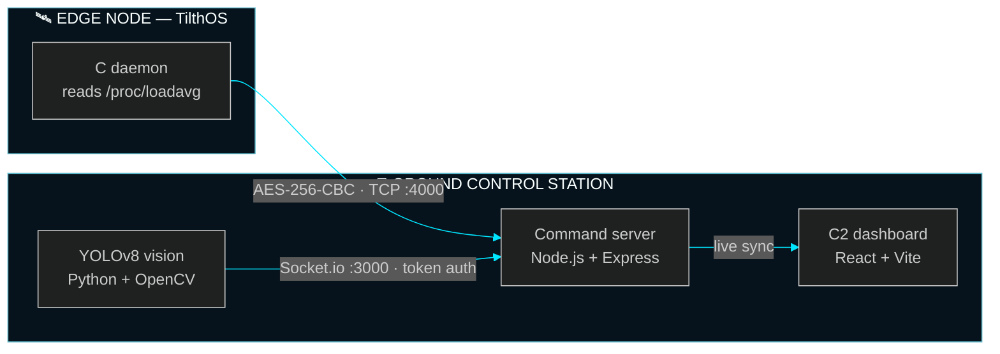

<!-- ═══════════════════ BOOT SEQUENCE ═══════════════════ -->
<p align="center">
  
</p>

<p align="center">
  
</p>

<p align="center">
  <a href="https://www.linkedin.com/in/okan-can-camc%C4%B1/"></a>
  <a href="mailto:camciokancan@gmail.com"></a>
  
</p>

<br/>

## `◉ SUBJECT PROFILE`

```yaml
# ───────────────────────────── IDENTITY SCAN COMPLETE ─────────────────────────────
designation     : Okan Can Camcı
callsign        : Tilhium
class           : Computer Engineering Student
base            : Türkiye 🇹🇷
status          : ONLINE ●
primary_ops     : [Edge AI, Embedded Linux, Full-Stack Web, LLM Agents]
specialties     : [Computer Vision, Secure Comms, Real-Time Systems]
side_quests     : [Compilers, Productivity Tools, Mobile Apps]
operating_style : "Build the whole stack — from the kernel to the dashboard."
threat_level    : "Will automate anything done twice."
```

I'm a computer engineering student who enjoys systems where **hardware, networking and AI meet**.
My favourite builds go end to end: a custom Linux image on the edge, encrypted data over the wire,
a model that understands it, and a live dashboard that shows it all.
Lately I've been working with **local LLMs and multi-agent systems**, and on the side I write
tools that make my own life easier: a productivity app with semantic search, lab-report generators,
and even a small compiler.

<br/>

## `◉ PRIMARY OPERATION — TILTH DETECTION SYSTEM`

> An **Edge-AI Command & Control (C2) simulation** that models a UAV ↔ ground-station link.
> A custom embedded Linux on the edge streams encrypted telemetry, a YOLOv8 vision module detects targets,
> and everything converges on a real-time tactical dashboard.



- **TilthOS:** a ~250 MB minimal Linux distro built from scratch with **Buildroot**, running under **QEMU**
- **Edge daemon:** statically compiled **C** program using POSIX system calls, encrypting telemetry with **AES-256-CBC**
- **Dual-channel backend:** Node.js merges raw TCP sensor data and authenticated WebSocket AI detections in real time
- **Tactical UI:** React dashboard that shows AI detections and edge-device CPU load side by side

[`▶ OPEN MISSION FILE`](https://github.com/Tilhium/Tilth-Detection-Project)

<br/>

## `◉ MISSION LOG`

| Codename | Briefing | Tech | Status |
|---|---|---|---|
| [**Tilth Detection**](https://github.com/Tilhium/Tilth-Detection-Project) | Edge-AI C2 simulation: custom Buildroot Linux, AES-256 telemetry, YOLOv8 detection, React tactical dashboard | `C` `Python` `YOLOv8` `Node.js` `React` | 🟢 `DEPLOYED` |
| [**Distributed AI Dev Platform**](https://github.com/Tilhium/dap_test) | Team project: a master agent splits a software requirement into tasks and assigns them to worker PCs running local LLMs (Ollama). Run with Scrum over five sprints | `FastAPI` `SQLAlchemy` `Ollama` `React` `TypeScript` | 🟡 `IN PROGRESS` |
| [**Focus**](https://github.com/Tilhium/Focus_Productivity_App) | AI-powered all-in-one productivity app: tasks, Pomodoro stats, book & anime tracking (AniList GraphQL), Notion-style wiki and semantic search with embeddings. Runs on desktop and web | `FastAPI` `sqlite-vec` `pywebview` `JavaScript` | 🟢 `DEPLOYED` |
| [**Sirius Chat**](https://github.com/Tilhium/Sirius-Chat-App-Demo) | Real-time messenger with AES-encrypted messages, brute-force lockout, group rooms, friend system, media sharing and read receipts | `React` `Socket.io` `Express` `MongoDB` | 🟢 `DEPLOYED` |
| [**Academic Journal Automaton**](https://github.com/Tilhium/Journal-Automation-Website) | Role-based platform covering a manuscript's full life cycle: submission, reviewer assignment, interactive PDF annotation, editorial decision | `Flask` `SQLAlchemy` `Alembic` `SQLite` | 🟢 `DEPLOYED` |
| [**Podcast Player**](https://github.com/Tilhium/PodcastPlayer-App) | Cross-platform podcast player app | `Dart` `Flutter` | 🟢 `DEPLOYED` |
| [**Text-to-Speech Converter**](https://github.com/Tilhium/Text-to-Speech-Converter-app-PythonFlask) | Web app that turns text into speech | `Python` `Flask` | 🟢 `DEPLOYED` |
| [**Spa Management System**](https://github.com/Tilhium/Spa-Management-System) | Desktop management system for a spa business | `Java` | 🟢 `DEPLOYED` |

<br/>

## `◉ CAPABILITY MATRIX`

| Domain | Systems |
|---|---|
| 🛰️ **Embedded & Edge** | Buildroot · QEMU · C · POSIX system calls · TCP sockets |
| 🧠 **AI / ML** | YOLOv8 · OpenCV · Ollama (local LLMs) · OpenAI API · embeddings & semantic search · Jupyter |
| 🔐 **Security** | AES-256-CBC · CryptoJS · bcrypt · token auth · brute-force protection |
| ⚙️ **Backend** | FastAPI · Flask · Node.js / Express · Socket.io · REST & GraphQL clients |
| 🖥️ **Frontend** | React · TypeScript · Vite · Tailwind · Jinja2 |
| 🗄️ **Data** | SQLite · sqlite-vec · MongoDB · MySQL · SQLAlchemy · Alembic |
| 📱 **Mobile & Desktop** | Flutter / Dart · pywebview · Java |
| 🛠️ **Low-level & Tooling** | C++ · compilers (scanner & parser) · Make · Git · Scrum |

<br/>

## `◉ LOADED MODULES`

<p align="center">
  <br/>
  <br/>
  
</p>

<br/>

## `◉ SYSTEM DIAGNOSTICS`

<p align="center">
  
  
</p>

<p align="center">
  
</p>

<p align="center">
  
</p>

<br/>

## `◉ CURRENT DIRECTIVES`

```diff
+ Building a distributed multi-agent LLM platform with my team
+ Writing a hand-made scanner & parser for a small calculator language
+ Going deeper into embedded Linux and edge computing
! Open to internships and collaboration in Edge AI, embedded or full-stack work
```

<br/>

<p align="center">
  
</p>
