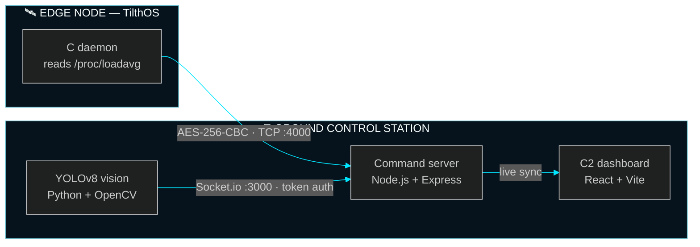

<!-- ═══════════════════ BOOT SEQUENCE ═══════════════════ -->
<p align="center">
  
</p>

<p align="center">
  
</p>

<p align="center">
  <a href="https://www.linkedin.com/in/okan-can-camc%C4%B1/"></a>
  <a href="mailto:camciokancan@gmail.com"></a>
  
  
</p>

<br/>

## `◉ SUBJECT PROFILE`

```yaml
# ───────────────────────────── IDENTITY SCAN COMPLETE ─────────────────────────────
designation     : Okan Can Çamcı
callsign        : Tilhium
class           : Computer Engineering — 4th year (Class of 2027)
training        : YÖK Digital University · AI School 2026–2027
                  (Modern Software Development & Machine Learning)
base            : Istanbul, Türkiye 🇹🇷
status          : ONLINE ●
primary_ops     : [AI & Data Science, Systems & Embedded, Full-Stack & Mobile]
specialties     : [Local LLMs, Multi-Agent Systems, Custom Linux, Computer Vision]
operating_style : "Build the whole stack — from the kernel to the dashboard."
threat_level    : "Will automate anything done twice."
```

I'm a 4th-year computer engineering student in Istanbul who likes working where **hardware, systems and AI meet**.
I build custom Linux distributions with Buildroot, write encrypted telemetry in C, run **local LLMs** with Ollama,
and wire it all together with backends, dashboards and mobile apps.
On the data side I work on **explainable ML** — XGBoost models made readable with SHAP and LLM-generated insights.

<br/>

## `◉ PRIMARY OPERATIONS`

### 🛰️ TilthOS & ZDuruOS — custom embedded Linux

> Minimal Linux systems built from scratch with **Buildroot**, running under QEMU / VirtualBox,
> with **kernel modules** and **encrypted telemetry daemons written in C**.

TilthOS powers the edge side of the **[Tilth Detection System](https://github.com/Tilhium/Tilth-Detection-Project)**,
an Edge-AI Command & Control simulation that models a UAV ↔ ground-station link:



### 🧠 Churn & Retention Analytics — explainable ML

> Customer churn prediction with **XGBoost**, explained feature by feature with **SHAP**,
> and turned into plain-language retention insights by a **local LLM**.

### 🤖 Distributed Multi-Agent Software Platform — team project

> An **orchestrator agent** breaks a software requirement into tasks, scores sub-agents by their measured
> capabilities and assigns the work to worker PCs running local LLMs over **Tailscale**. Built with Scrum.
> I own the project contract, requirements and setup documentation.
> **[→ repository](https://github.com/Tilhium/dap_test)**

<br/>

## `◉ MISSION LOG`

| Codename | Briefing | Tech | Status |
|---|---|---|---|
| [**Tilth Detection**](https://github.com/Tilhium/Tilth-Detection-Project) | Edge-AI C2 simulation: TilthOS, AES-256 telemetry, YOLOv8 detection, React tactical dashboard | `C` `Buildroot` `YOLOv8` `Node.js` `React` | 🟢 `DEPLOYED` |
| [**Distributed AI Platform**](https://github.com/Tilhium/dap_test) | Orchestrator + sub-agent architecture distributing software tasks to local LLM workers | `FastAPI` `SQLAlchemy` `Ollama` `React` `TS` | 🟡 `IN PROGRESS` |
| **ZDuruOS** | Second Buildroot-based minimal Linux with kernel modules and encrypted telemetry | `C` `Buildroot` `QEMU` | 🔒 `CLASSIFIED` |
| **Churn & Retention Analytics** | XGBoost churn model + SHAP explainability + local-LLM insight reports | `Python` `XGBoost` `SHAP` `Ollama` | 🔒 `CLASSIFIED` |
| **F.R.I.D.A.Y.** | Personal voice assistant | `Python` `LLM` | 🔒 `CLASSIFIED` |
| **Local File Summarizer** | Ollama agent that reads and summarizes files on the local disk | `Python` `Ollama` | 🔒 `CLASSIFIED` |
| [**Focus**](https://github.com/Tilhium/Focus_Productivity_App) | Desktop productivity app: tasks, Pomodoro stats, book & anime tracking, Notion-style wiki, semantic search with embeddings | `FastAPI` `sqlite-vec` `pywebview` | 🟢 `DEPLOYED` |
| [**Sirius Chat**](https://github.com/Tilhium/Sirius-Chat-App-Demo) | Real-time messenger with AES-encrypted messages, brute-force lockout, rooms, friends and media sharing | `React` `Socket.io` `Express` `MongoDB` | 🟢 `DEPLOYED` |
| [**Academic Journal Automaton**](https://github.com/Tilhium/Journal-Automation-Website) | Role-based manuscript life cycle: submission, reviewer assignment, PDF annotation, editorial decision | `Flask` `SQLAlchemy` `SQLite` | 🟢 `DEPLOYED` |
| **DB Architecture Tool** | Tool for designing database architectures | `SQL` `Python` | 🔒 `CLASSIFIED` |
| **Modular Encryption Suite** | Collection of modular encryption projects | `C` `Python` | 🔒 `CLASSIFIED` |
| [**Podcast Player**](https://github.com/Tilhium/PodcastPlayer-App) | Cross-platform podcast player | `Flutter` `Dart` | 🟢 `DEPLOYED` |

<sub>🔒 `CLASSIFIED` = not public yet.</sub>

<br/>

## `◉ CAPABILITY MATRIX`

| Domain | Systems |
|---|---|
| 🧠 **AI & Data Science** | Machine learning · XGBoost · SHAP · Ollama (`qwen3`, `qwen2.5`, `llama3`) · multi-agent systems · OpenCV · YOLOv8 · Jupyter |
| 🛰️ **Systems & Embedded** | Buildroot (TilthOS, ZDuruOS) · Linux kernel modules · C systems programming · ARM Cortex-M4 / STM32F407 · compiler design (Flex) |
| ⚙️ **Backend** | Python (FastAPI, Flask) · Node.js / Express · Socket.io · SQL |
| 🖥️ **Frontend & Mobile** | JavaScript · React · TypeScript · Vite · Flutter / Dart |
| 🔐 **Security** | AES-256-CBC · encrypted telemetry · bcrypt · token auth · brute-force protection |
| 🗄️ **Data** | MySQL · SQLite · sqlite-vec · MongoDB · SQLAlchemy |
| 🧰 **Environment** | Linux · WSL2 (Ubuntu) · Docker · Tailscale · QEMU · VirtualBox · Git & GitHub |

<br/>

## `◉ LOADED MODULES`

<p align="center">
  <br/>
  <br/>
  
</p>

<br/>

## `◉ SYSTEM DIAGNOSTICS`

<p align="center">
  
  
</p>

<p align="center">
  
</p>

<p align="center">
  
</p>

<br/>

## `◉ CURRENT DIRECTIVES`

```diff
+ YÖK Digital University AI School — modern software development & machine learning
+ Building a distributed multi-agent LLM platform with my team
+ Going deeper into kernel modules, STM32 firmware and custom Linux builds
+ Making ML models explainable with SHAP + local LLMs
! Open to internships and collaboration in AI, embedded systems or full-stack work
```

<br/>

## `◉ OFF-DUTY SUBROUTINES`

<p align="center">
  
  
  
  
  <br/>
  
  
  
  
</p>

<br/>

<p align="center">
  
</p>
